# Shattered Realities

An ordinary room, and a person in it, slowly lose their grip on reality. Walls drift, the sun
slides out of the window, colours drain away and a shadow figure starts pacing the room.
Then everything recovers.

**Every pixel is produced by graphics algorithms we wrote ourselves.** The program has its own
framebuffer (a grid of RGB pixels). Lines, circles, polygons, curves, clipping,
transformations, sprites and animation are all computed in our C++ code. No graphics
library draws anything. The operating system is only asked to show the finished image.

| Healthy (distortion 0.0) | Shattered (distortion 1.0) |
|---|---|
| 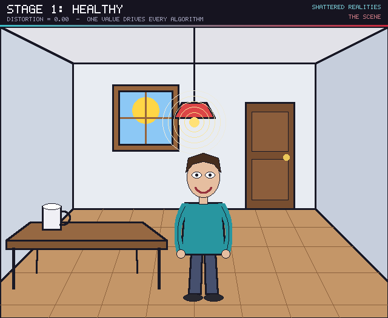 | 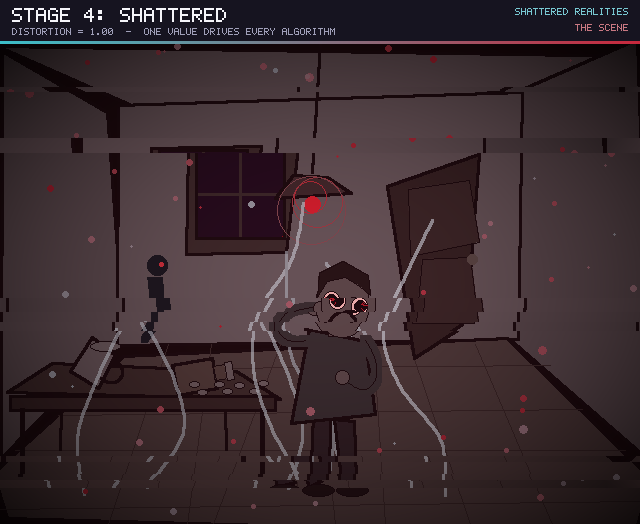 |

## Purpose

The story is driven by **one number, `distortion`, from 0 (healthy) to 1 (shattered)**. Every
technique in the course reacts to it, so the graphics are what carry the story:

* the sun polygon drifts out of the window and **Sutherland-Hodgman clipping** hides the overflow;
* **scanline-filled** walls warp, and the door and mug **rotate about their pivots** (3x3 matrices);
* the arms and mouth are **Bezier curves** whose control points tween from relaxed to clutching,
  and from smile to frown;
* smoke is drawn with **Catmull-Rom splines** on its own layer and alpha-blended in, and the
  colours are **interpolated** towards a decayed palette;
* a **masked, alpha-blended sprite** with a walk cycle appears and paces the back wall;
* **raster post-processing** adds a vignette and horizontal "tearing" bands made with bit-blits.

## Running it

Requires CMake 3.16+, Ninja and a C++20 compiler (tested with MinGW-w64 g++ 16).
No other libraries are needed.

**VS Code:** install the C/C++ and CMake Tools extensions, open the folder and pick the
`MinGW Release` preset for presenting (`MinGW Debug` for debugging). F5 runs the
**Live viewer**. The second launch configuration, **Export images**, regenerates `output/`.

**Command line:**

```sh
cmake --preset mingw-release
cmake --build --preset mingw-release
./build/release/shattered_realities            # live, animated viewer (Windows)
./build/release/shattered_realities --export   # write every image to output/ as PNG
```

On non-Windows systems the program always exports images (the viewer uses Win32).

### Live viewer controls

| Key | Action |
|---|---|
| `Space` | pause / play |
| `←` `→` (hold) | scrub the distortion by hand (`R` returns to the story) |
| `R` | restart the story |
| `C` | show the **construction lines**: Bezier control points, spline points, pivots, clip window |
| `B` | turn **double buffering** off/on. Off, the screen flickers |
| `V` | VSync on/off (the FPS counter shows the difference) |
| `1`–`8`, `Tab`, `0` | technique pages, next page, back to the scene |
| `F11` | fullscreen (for the projector) |
| `P` | save a screenshot to `output/screenshots/` |
| `H`, `Esc` | hide help, quit |

## Graphics techniques implemented

| Technique | Code | Where it is used and why |
|---|---|---|
| DDA and Bresenham lines, thick lines | [lines.cpp](src/lines.cpp) | Every outline and edge. Bresenham is integer-only, so it is used for drawing; DDA is kept for comparison (1.26 % of pixels differ). |
| Midpoint circle and ellipse | [circles.cpp](src/circles.cpp) | Head, eyes, pupils (dilate with distortion), lamp halo, pills, mug rim. |
| Scanline polygon fill (even-odd), boundary and flood fill | [polygon.cpp](src/polygon.cpp) | All walls, furniture and clothing. Even-odd handles concave and self-intersecting shapes. |
| Cohen-Sutherland, Liang-Barsky, Sutherland-Hodgman clipping | [clipping.cpp](src/clipping.cpp) | The sun polygon is clipped to the window glass as it drifts away. The two line clippers agree on all test lines. |
| Bezier (de Casteljau, any degree), Catmull-Rom splines | [curves.cpp](src/curves.cpp) | Arms, mouth and mug handle (Bezier); smoke wisps (Catmull-Rom passes through its points). |
| 2D transformations with 3x3 homogeneous matrices | [transform.cpp](src/transform.cpp) | Door hinge and mug rotations, lamp swing, breathing torso (scale about a pivot), sprite limb posing, shear. |
| Colour interpolation, desaturation, darkening | [framebuffer.cpp](src/framebuffer.cpp) | The healthy-to-decayed palette, the HUD distortion bar. |
| Bit-blit with COPY / AND / OR / XOR, colour-key masks | [raster.cpp](src/raster.cpp) | Glitch bands (row blits), XOR construction overlay, composing pages, presenting frames. |
| Alpha blending `src*a + dst*(1-a)` | [raster.cpp](src/raster.cpp) | Ghostly shadow figure, translucent smoke layer, HUD panels, fading messages. |
| Sprites and sprite sheets | [sprites.cpp](src/sprites.cpp) | 8-frame walk cycle generated with our own primitives, drawn with a mask and alpha. |
| Animation: delta time, keyframes, tweening, easing, frame timer | [animation.cpp](src/animation.cpp) | The story is a keyframe track of `distortion`. The walk cycle has its own 9 fps timer, and movement uses `x += v * dt`. |
| Double buffering and VSync | [app_win32.cpp](src/app_win32.cpp) | Each frame is finished in a back buffer, then shown with one block transfer. `B` and `V` demonstrate both live. |
| Bitmap font (masked glyph blits) | [font.cpp](src/font.cpp) | All labels and the HUD. |
| PNG encoding (DEFLATE + LZ77) | [png.cpp](src/png.cpp) | Saving raster images compactly. |

The **technique pages** (exported to `output/`, and shown live with keys `1`–`8`) demonstrate
each technique on its own:

| | | |
|---|---|---|
| 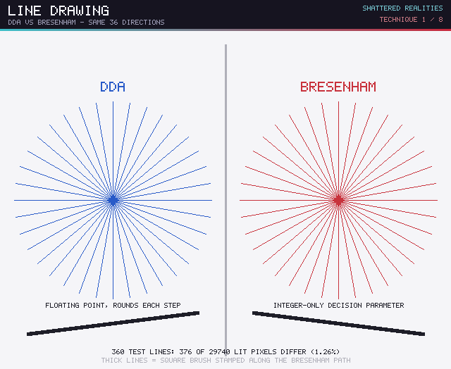 | 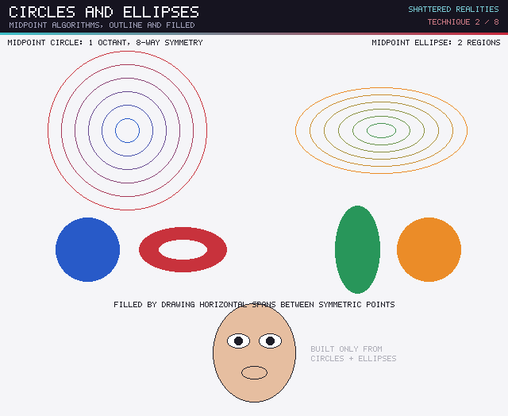 | 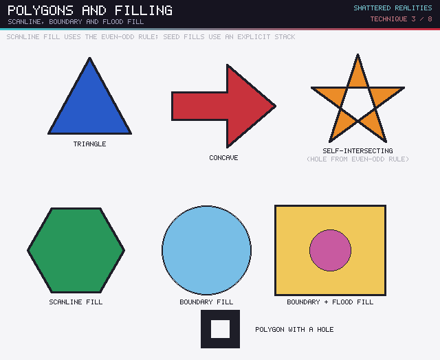 |
| 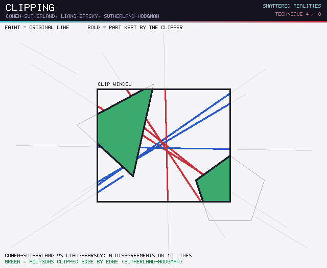 | 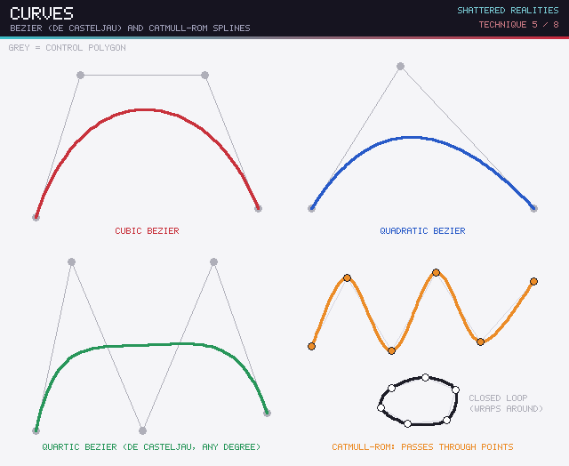 | 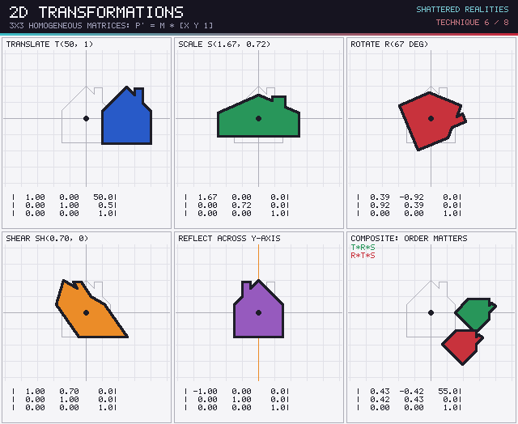 |
| 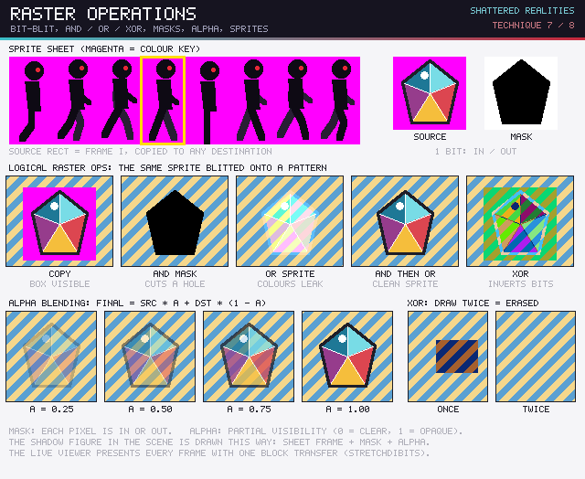 | 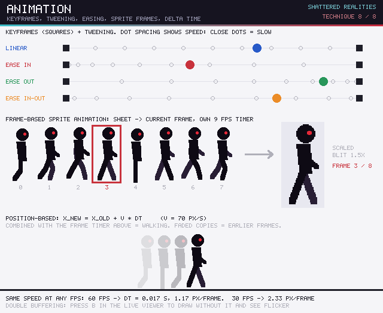 | 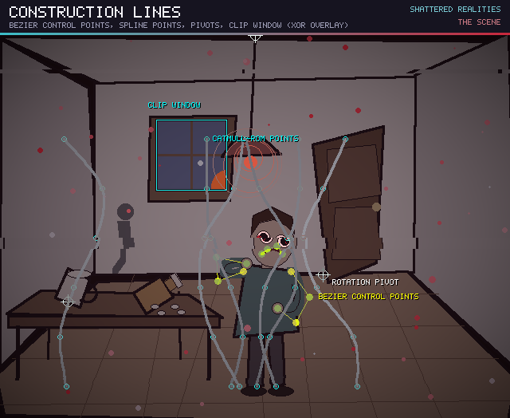 |

## How a frame is made

```
 keyframe track ──► distortion ──► renderScene() ──► canvas (640x480 framebuffer)
 elapsed time dt ─┘                  │ lines, circles, fills, curves, clipping,
                                     │ matrices, sprites, alpha, post-processing
                                     ▼
              caption bar + HUD ──► back buffer (640x524) ──► one block transfer ──► window
```

## Project structure

```
include/, src/
  framebuffer   pixel grid, colour helpers, BMP/PPM output      png         PNG encoder
  lines         DDA, Bresenham, thick lines                     circles     midpoint circle/ellipse
  polygon       scanline / boundary / flood fill                clipping    line and polygon clipping
  curves        Bezier, Catmull-Rom                             transform   3x3 matrices
  raster        bit-blit, raster ops, masks, alpha, sprites     sprites     generated sprite sheets
  animation     easing, keyframes, frame timer, frame clock     font        5x7 bitmap font
  scene         the Shattered Realities room                    demos       technique pages + export
  app_win32     live viewer (window, input, present)            main        entry point
output/         exported images (regenerate with --export)
```

## Technologies

C++20, CMake + Ninja, MinGW-w64 g++. The live viewer uses only Win32 (`user32`, `gdi32`,
`dwmapi`), which ships with Windows: it opens the window, reads keys and copies our finished
framebuffer to the screen.

## Contributors

| Member | Role | Responsibilities |
|---|---|---|
| Ivan Gichana ([@aigichana](https://github.com/aigichana)) | Project Manager & Storyboard | Story and storyboard, the `distortion` keyframe timeline, project planning, documentation and presentation |
| Issac Njuguna | Lead Modeler | DDA and Bresenham lines, midpoint circles and ellipses, scanline, boundary and flood fill ([lines.cpp](src/lines.cpp), [circles.cpp](src/circles.cpp), [polygon.cpp](src/polygon.cpp)) |
| Nick Mugo | Lead Animator | 3x3 transformation matrices, Bezier curves, keyframes and easing, the walk cycle ([transform.cpp](src/transform.cpp), [curves.cpp](src/curves.cpp), [animation.cpp](src/animation.cpp), [sprites.cpp](src/sprites.cpp)) |
| James Muthama | VFX & Lighting | Colour decay, vertex warp, clipping, Catmull-Rom smoke, alpha blending, glitch bands and vignette ([clipping.cpp](src/clipping.cpp), [raster.cpp](src/raster.cpp)) |
| Precious Waweru | Graphics Integration & Testing | Scene assembly, live viewer, double buffering and VSync, construction overlay, PNG export, algorithm checks ([scene.cpp](src/scene.cpp), [app_win32.cpp](src/app_win32.cpp), [png.cpp](src/png.cpp)) |

## Checkpoint progress

| Checkpoint | Scope | Status | Evidence |
|---|---|---|---|
| CP1: Technical foundation | Core algorithms in pure C++, simple project components | Done | Pages 1 to 5, scene stages 1 to 4 |
| CP2: Transformation and animation | Matrices, keyframes, tweening, sprites | Done (ahead of week 10) | Pages 6 to 8, live animated viewer |
| CP3: OpenGL integration and prototype | Move the components to OpenGL | Planned | See *Future work* |
| Final project | Interaction, polish, complete story | Planned | See *Future work* |

## Future work and recommendations

* **OpenGL (CP3), in two steps.** First, upload our finished framebuffer to an OpenGL texture
  and draw it on a full-screen quad. This keeps every algorithm we wrote and changes only how the
  frame reaches the screen. Then move the scene objects to vertex buffers and shaders one at a time,
  using the current CPU renderer as a reference image to check each one against.
* **Bring back what the proposal deferred.** OpenGL makes the parts of the original proposal that
  need 3D possible again: a 3D room and character, Gouraud and Phong shading with real light
  sources, Bezier camera paths and hierarchical rigging. As proposed, the project stays a
  non-interactive animation; the keys only control the presentation.
* **Keep what works.** The `--export` mode and the built-in algorithm checks (DDA vs Bresenham,
  Cohen-Sutherland vs Liang-Barsky) should stay as regression tests through the OpenGL port.
* **Possible removals.** The BMP/PPM writers are no longer used now that PNG export exists.

## Lessons learnt

* **One control value keeps a complex scene manageable.** Driving everything from `distortion`
  meant every new effect could be tested by scrubbing a single slider.
* **Comparing two algorithms on the same input finds bugs quickly.** Running DDA against
  Bresenham, and Cohen-Sutherland against Liang-Barsky, gave us a numerical check, not just a
  picture to eyeball.
* **Transformation order matters.** `T·R·S` and `R·T·S` give different results, and rotating
  about a pivot needs `T(p)·R·T(-p)`. Page 6 shows both.
* **Randomness must be repeatable in animation.** Using a hash of (object, vertex) instead of
  `rand()` keeps the warped walls stable from frame to frame instead of shaking.
* **Time-based animation beats frame-based.** Moving by `v·dt` keeps the story the same length
  on a fast laptop and a slow projector.
